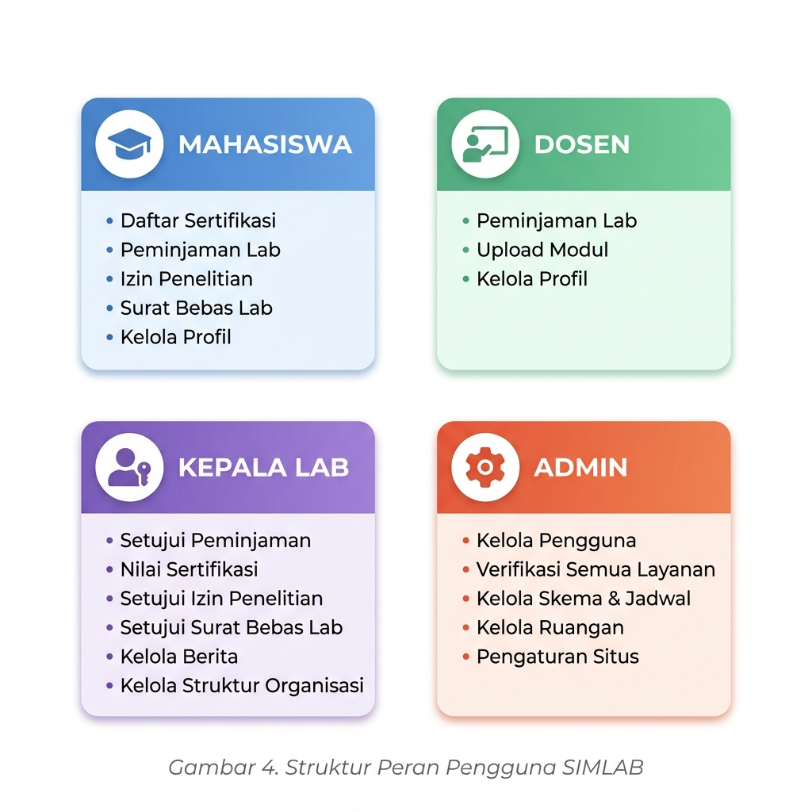
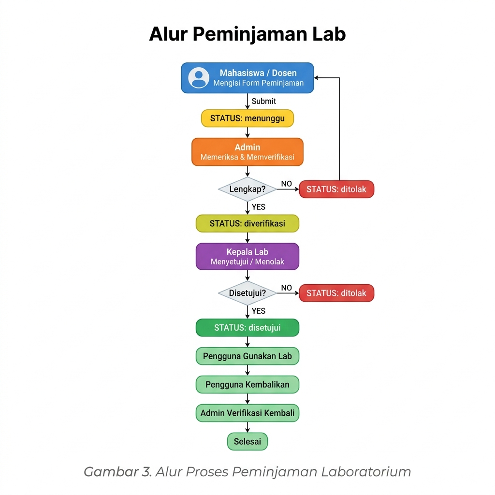
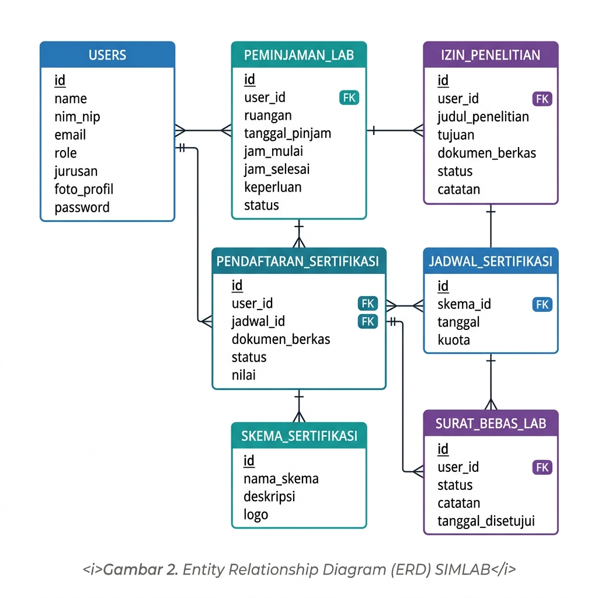
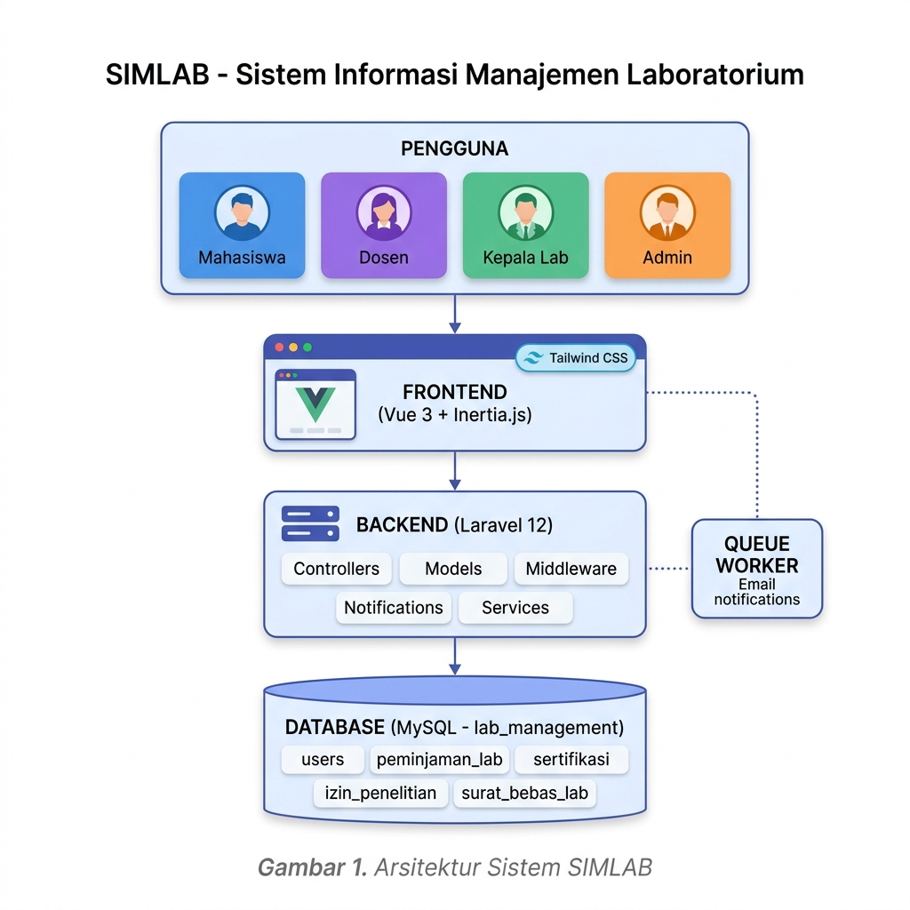

# 📘 MANUAL BOOK — SIMLAB
## Sistem Informasi Manajemen Laboratorium
### STMIK Samarinda

---

## Daftar Gambar

| No | Gambar | Halaman/Bab |
|----|--------|-----------|
| Gambar 1 | Arsitektur Sistem SIMLAB | Bab 10 |
| Gambar 2 | Entity Relationship Diagram (ERD) SIMLAB | Bab 9 |
| Gambar 3 | Alur Proses Peminjaman Laboratorium | Bab 5 |
| Gambar 4 | Struktur Peran Pengguna SIMLAB | Bab 4 |

---

## Daftar Isi

1. [Pendahuluan](#1-pendahuluan)
2. [Spesifikasi Sistem](#2-spesifikasi-sistem)
3. [Instalasi & Konfigurasi](#3-instalasi--konfigurasi)
4. [Struktur Peran Pengguna](#4-struktur-peran-pengguna)
5. [Panduan Mahasiswa](#5-panduan-mahasiswa)
6. [Panduan Dosen](#6-panduan-dosen)
7. [Panduan Kepala Lab](#7-panduan-kepala-lab)
8. [Panduan Admin](#8-panduan-admin)
9. [Struktur Database](#9-struktur-database)
10. [Arsitektur Sistem](#10-arsitektur-sistem)
11. [Notifikasi Sistem](#11-notifikasi-sistem)
12. [Troubleshooting](#12-troubleshooting)

---

## 1. Pendahuluan

**SIMLAB** (Sistem Informasi Manajemen Laboratorium) adalah aplikasi web berbasis Laravel yang dirancang untuk mengelola seluruh kegiatan operasional laboratorium di STMIK Samarinda. Sistem ini memungkinkan pengelolaan peminjaman ruang lab, pendaftaran sertifikasi, izin penelitian, dan surat bebas lab secara digital dan terintegrasi.

### 1.1 Tujuan Sistem

- Digitalisasi proses peminjaman laboratorium
- Pengelolaan pendaftaran & pelaksanaan sertifikasi mahasiswa
- Otomatisasi pengajuan izin penelitian
- Penerbitan surat bebas lab secara elektronik
- Manajemen berita & informasi seputar laboratorium
- Pengelolaan struktur organisasi lab

### 1.2 Fitur Utama

| Fitur | Mahasiswa | Dosen | Kepala Lab | Admin |
|-------|-----------|-------|------------|-------|
| Peminjaman Lab | ✅ | ✅ | ✅ (approve) | ✅ (verifikasi) |
| Sertifikasi | ✅ | ❌ | ✅ (nilai) | ✅ (verifikasi) |
| Izin Penelitian | ✅ | ❌ | ✅ (approve) | ✅ (verifikasi) |
| Surat Bebas Lab | ✅ | ❌ | ✅ (approve) | ✅ |
| Kelola Berita | ❌ | ❌ | ✅ | ✅ |
| Kelola Pengguna | ❌ | ❌ | ❌ | ✅ |
| Kelola Jadwal Sertifikasi | ❌ | ❌ | ❌ | ✅ |
| Upload Modul | ❌ | ✅ | ❌ | ❌ |

---

## 2. Spesifikasi Sistem

### 2.1 Teknologi yang Digunakan

| Komponen | Teknologi | Versi |
|----------|-----------|-------|
| Backend Framework | Laravel | 12.x |
| Frontend Framework | Vue.js (Inertia.js) | 3.x |
| Database | MySQL | 5.7+ / 8.x |
| Build Tool | Vite | 5.x |
| CSS Framework | Tailwind CSS | 3.x + 4.x |
| State Management | Pinia | 2.x |
| Auth | Laravel Sanctum | 4.3 |
| Alert Library | SweetAlert2 | 11.x |

### 2.2 Kebutuhan Server

| Kebutuhan | Minimum |
|-----------|---------|
| PHP | 8.2+ |
| MySQL | 5.7+ |
| Node.js | 18+ |
| Composer | 2.x |
| Web Server | Apache (XAMPP) / Nginx |
| RAM | 512 MB |
| Storage | 1 GB |

---

## 3. Instalasi & Konfigurasi

### 3.1 Instalasi via XAMPP (Lokal)

```bash
# 1. Clone atau salin project ke folder htdocs
# Lokasi: C:\xampp\htdocs\SIMLAB

# 2. Instal dependency PHP
composer install

# 3. Instal dependency Node.js
npm install

# 4. Salin file environment
copy .env.example .env

# 5. Generate application key
php artisan key:generate

# 6. Build aset frontend
npm run build
```

### 3.2 Konfigurasi Database (.env)

Buka file `.env` dan sesuaikan pengaturan berikut:

```env
APP_NAME=SIMLAB
APP_ENV=production
APP_DEBUG=false
APP_URL=http://localhost/SIMLAB/public

DB_CONNECTION=mysql
DB_HOST=localhost
DB_PORT=3306
DB_DATABASE=lab_management
DB_USERNAME=root
DB_PASSWORD=
```

### 3.3 Konfigurasi Email (Opsional)

```env
MAIL_MAILER=smtp
MAIL_HOST=sandbox.smtp.mailtrap.io
MAIL_PORT=2525
MAIL_USERNAME=your_mailtrap_username
MAIL_PASSWORD=your_mailtrap_password
MAIL_FROM_ADDRESS="no-reply@simlab.stmik.ac.id"
```

### 3.4 Migrasi Database

```bash
# Buat database di phpMyAdmin bernama: lab_management

# Jalankan migrasi
php artisan migrate

# (Opsional) Jalankan seeder untuk data awal
php artisan db:seed
```

### 3.5 Menjalankan Aplikasi

```bash
# Mode Development (semua service berjalan bersamaan)
composer dev

# Atau jalankan manual:
php artisan serve          # Backend (port 8000)
npm run dev                # Frontend Vite
php artisan queue:listen   # Queue untuk notifikasi
```

Akses aplikasi di: `http://127.0.0.1:8000`

---

## 4. Struktur Peran Pengguna

SIMLAB memiliki **4 peran pengguna**:

### 4.1 Mahasiswa
- Pengguna yang terdaftar dengan email domain mahasiswa
- Dapat mengajukan peminjaman lab, sertifikasi, izin penelitian, dan surat bebas lab
- **Wajib melengkapi profil** sebelum mengakses fitur utama

### 4.2 Dosen
- Pengguna dengan email domain pegawai/dosen
- Dapat meminjam laboratorium untuk keperluan pengajaran
- Dapat mengunggah modul pembelajaran

### 4.3 Kepala Lab
- Pejabat laboratorium dengan akses persetujuan
- Menyetujui/menolak peminjaman, izin penelitian, sertifikasi
- Mengelola berita dan struktur organisasi

### 4.4 Admin
- Administrator sistem dengan akses penuh
- Mengelola pengguna, skema, jadwal, ruangan, program studi
- Memverifikasi semua pengajuan sebelum ke Kepala Lab

### 4.5 Diagram Peran Pengguna



*Gambar 4. Struktur Peran Pengguna SIMLAB*

### 4.6 Alur Login

1. Buka halaman `http://127.0.0.1:8000`
2. Klik tombol **"Masuk"** di pojok kanan atas
3. Masukkan email dan password
4. Sistem akan otomatis mengarahkan ke dashboard sesuai peran

---

## 5. Panduan Mahasiswa

**URL Dashboard:** `/mahasiswa/dashboard`

> ⚠️ **Penting:** Lengkapi profil terlebih dahulu sebelum menggunakan fitur layanan. Pergi ke **Profil** → isi NIM, jurusan, foto profil.

### 5.1 Pendaftaran Sertifikasi

**URL:** `/mahasiswa/sertifikasi`

**Langkah-langkah:**
1. Klik menu **"Sertifikasi"** di sidebar
2. Pilih tab **"Daftar Sertifikasi"** untuk melihat jadwal tersedia
3. Klik tombol **"Daftar"** pada jadwal yang diinginkan
4. Unggah dokumen persyaratan (format: PDF/JPG, maks 2MB)
5. Klik **"Kirim Pendaftaran"**
6. Pantau status di tab **"Riwayat Sertifikasi"**

**Status Pendaftaran Sertifikasi:**

| Status | Keterangan |
|--------|------------|
| `menunggu` | Pendaftaran terkirim, menunggu verifikasi admin |
| `diverifikasi` | Sudah diverifikasi admin, menunggu penilaian |
| `lulus` | Dinyatakan lulus oleh Kepala Lab |
| `tidak_lulus` | Tidak lulus, dapat mendaftar kembali |

**Cetak Sertifikat:**
- Hanya tersedia jika status = `lulus`
- Klik **"Cetak Sertifikat"** → sistem generate PDF otomatis

### 5.2 Peminjaman Lab (Mahasiswa)

**URL:** `/mahasiswa/peminjaman-lab`

**Alur Proses Peminjaman:**



*Gambar 3. Alur Proses Peminjaman Laboratorium*

**Langkah-langkah:**
1. Klik **"Peminjaman Lab"** → **"Buat Permohonan Baru"**
2. Isi form:
   - **Ruangan:** Pilih lab yang tersedia
   - **Tanggal Pinjam:** Pilih tanggal (minimal H+1)
   - **Jam Mulai & Selesai:** Tentukan durasi penggunaan
   - **Keperluan:** Jelaskan tujuan peminjaman
   - **Surat Keterangan:** Upload surat pendukung (jika diperlukan)
3. Klik **"Ajukan Permohonan"**
4. Pantau status di daftar peminjaman

**Alur Status Peminjaman:**

```
Mahasiswa Ajukan → [menunggu] → Admin Verifikasi → [diverifikasi]
                                                         ↓
                                          Kepala Lab Setujui → [disetujui]
                                          Kepala Lab Tolak  → [ditolak]
```

**Pengembalian Lab:**
- Setelah selesai menggunakan, klik **"Kembalikan"**
- Sistem mencatat waktu pengembalian otomatis
- Cetak **Bukti Peminjaman** dan **Bukti Pengembalian** tersedia

### 5.3 Izin Penelitian

**URL:** `/mahasiswa/izin-penelitian`

**Langkah-langkah:**
1. Klik **"Izin Penelitian"** → **"Buat Permohonan"**
2. Isi form:
   - **Judul Penelitian**
   - **Tujuan Penelitian**
   - **Data yang Dibutuhkan** (checklist)
   - **Dokumen Berkas:** Upload surat/proposal penelitian
3. Klik **"Ajukan Permohonan"**

**Status Izin Penelitian:**

| Status | Keterangan |
|--------|------------|
| `menunggu` | Menunggu verifikasi |
| `diverifikasi` | Sudah diverifikasi admin |
| `disetujui` | Disetujui Kepala Lab, surat bisa dicetak |
| `ditolak` | Ditolak dengan catatan |

### 5.4 Surat Bebas Lab

**URL:** `/mahasiswa/surat-bebas-lab`

Surat ini diperlukan untuk keperluan wisuda/kelulusan.

**Langkah-langkah:**
1. Klik **"Surat Bebas Lab"**
2. Klik **"Ajukan Surat Bebas Lab"**
3. Konfirmasi pengajuan
4. Pantau status permohonan

**Status Surat Bebas Lab:**

| Status | Keterangan |
|--------|------------|
| `menunggu` | Menunggu pengecekan admin |
| `masih_tanggungan` | Masih ada tanggungan (peminjaman/dll) |
| `diverifikasi` | Sudah diverifikasi |
| `disetujui` | Disetujui, surat dapat dicetak |

---

## 6. Panduan Dosen

**URL Dashboard:** `/dosen/dashboard`

### 6.1 Peminjaman Lab (Dosen)

**URL:** `/dosen/peminjaman-lab`

Proses peminjaman untuk dosen serupa dengan mahasiswa namun tanpa syarat profil lengkap.

**Langkah-langkah:**
1. Klik **"Peminjaman Lab"** → **"Buat Permohonan"**
2. Isi detail peminjaman (ruangan, tanggal, jam, keperluan)
3. Klik **"Ajukan"**
4. Untuk pengembalian: Klik **"Kembalikan"** pada permohonan yang aktif

### 6.2 Upload Modul

**URL:** `/dosen/modul`

1. Klik **"Modul"** di sidebar
2. Klik **"Upload Modul Baru"**
3. Isi judul dan pilih file modul (PDF)
4. Klik **"Simpan"**
5. Untuk menghapus: Klik ikon **🗑️ Hapus** pada modul yang dipilih

---

## 7. Panduan Kepala Lab

**URL Dashboard:** `/kepala_lab/dashboard`

### 7.1 Persetujuan Peminjaman Lab

**URL:** `/kepala_lab/peminjaman-lab`

1. Lihat daftar peminjaman yang sudah diverifikasi admin
2. Klik **"Lihat Detail"** untuk memeriksa informasi
3. Pilih aksi:
   - **"Setujui"** → Status berubah ke `disetujui`
   - **"Tolak"** → Masukkan alasan penolakan

### 7.2 Penilaian Sertifikasi

**URL:** `/kepala_lab/sertifikasi`

1. Pilih pendaftaran yang sudah diverifikasi admin
2. Klik **"Beri Nilai"**
3. Masukkan nilai (0-100)
4. Sistem otomatis menentukan **Lulus** atau **Tidak Lulus**

### 7.3 Persetujuan Izin Penelitian

**URL:** `/kepala_lab/izin-penelitian`

1. Lihat daftar pengajuan izin penelitian
2. Klik **"Detail"** → review dokumen
3. Klik **"Setujui"** atau **"Tolak"** (dengan catatan)

### 7.4 Surat Bebas Lab

**URL:** `/kepala_lab/surat-bebas-lab`

1. Lihat daftar pengajuan surat bebas lab
2. Klik **"Setujui"** untuk menerbitkan surat
3. Klik **"Cetak Surat"** untuk mencetak dokumen resmi

### 7.5 Kelola Berita

**URL:** `/admin/berita` *(juga dapat diakses Kepala Lab)*

1. Klik **"Tambah Berita"**
2. Isi judul, kategori, ringkasan, konten, dan gambar
3. Klik **"Simpan"**

### 7.6 Kelola Struktur Organisasi

**URL:** `/kepala_lab/struktur`

1. Tambahkan anggota struktur dengan nama, jabatan, foto, dan urutan tampil
2. Edit atau hapus data yang sudah ada

---

## 8. Panduan Admin

**URL Dashboard:** `/admin/dashboard`

### 8.1 Manajemen Pengguna

**URL:** `/admin/users`

**Tambah Pengguna:**
1. Klik **"Tambah Pengguna"**
2. Isi: Nama, Email, NIM/NIP, Jurusan, Peran, Password
3. Klik **"Simpan"**

**Edit/Hapus Pengguna:**
- Klik ikon **✏️ Edit** atau **🗑️ Hapus** pada baris pengguna

**Peran Tersedia:** `mahasiswa`, `dosen`, `kepala_lab`, `admin`

### 8.2 Verifikasi Peminjaman Lab

**URL:** `/admin/peminjaman-lab`

1. Lihat daftar peminjaman masuk
2. Klik **"Detail"** untuk memeriksa kelengkapan
3. Klik **"Verifikasi"** → lanjut ke Kepala Lab
4. Klik **"Tolak"** → permohonan ditolak

> Setelah pengembalian dilakukan pengguna, Admin memverifikasi kembali dengan klik **"Verifikasi Kembali"**.

### 8.3 Verifikasi Sertifikasi

**URL:** `/admin/sertifikasi`

1. Pilih pendaftaran berstatus `menunggu`
2. Klik **"Verifikasi"** → status berubah ke `diverifikasi`
3. Admin juga dapat langsung tentukan **Lulus** atau **Tidak Lulus**

### 8.4 Verifikasi Izin Penelitian

**URL:** `/admin/izin-penelitian`

1. Klik **"Detail"** pada permohonan masuk
2. Klik **"Verifikasi"** atau **"Tolak"**

### 8.5 Kelola Skema Sertifikasi

**URL:** `/admin/skema`

| Aksi | Keterangan |
|------|------------|
| Tambah Skema | Nama, deskripsi, logo skema |
| Edit Skema | Ubah informasi skema |
| Hapus Skema | Hapus skema (pastikan tidak ada jadwal aktif) |

### 8.6 Kelola Jadwal Sertifikasi

**URL:** `/admin/jadwal`

1. Klik **"Buat Jadwal"**
2. Pilih **Skema**, tentukan **Tanggal** dan **Kuota peserta**
3. Klik **"Simpan"**

> ℹ️ Setiap jadwal baru dibuat, sistem otomatis mengirim notifikasi ke semua mahasiswa terdaftar.

### 8.7 Kelola Ruangan

**URL:** `/admin/ruangan`

1. Tambah ruangan dengan nama, deskripsi, dan fasilitas
2. Edit atau hapus data ruangan

### 8.8 Kelola Program Studi

**URL:** `/admin/program-studi`

1. Tambahkan Program Studi baru
2. Data ini digunakan pada formulir profil mahasiswa

### 8.9 Pengaturan Situs

**URL:** `/admin/site-setting`

| Pengaturan | Keterangan |
|------------|------------|
| Nama Website | Nama yang tampil di header |
| Nama Kampus | Nama institusi |
| Logo | Upload logo kampus |
| Tema Warna | Pilih antara Ungu atau Merah |
| Domain Email | Validasi email mahasiswa & pegawai |
| Kontak | Alamat, telepon, email, media sosial |
| Galeri | Upload foto-foto laboratorium |

---

## 9. Struktur Database

### 9.1 Tabel Utama

| Tabel | Keterangan |
|-------|------------|
| `users` | Data semua pengguna sistem |
| `skema_sertifikasi` | Skema/jenis sertifikasi |
| `jadwal_sertifikasi` | Jadwal pelaksanaan sertifikasi |
| `pendaftaran_sertifikasi` | Pendaftaran mahasiswa ke jadwal |
| `peminjaman_lab` | Data peminjaman ruang laboratorium |
| `izin_penelitian` | Pengajuan izin penelitian mahasiswa |
| `surat_bebas_lab` | Pengajuan surat bebas lab |
| `ruangan` | Data ruangan/lab yang tersedia |
| `beritas` | Konten berita/informasi |
| `moduls` | Modul pembelajaran dari dosen |
| `struktur_organisasis` | Struktur organisasi lab |
| `program_studis` | Daftar program studi |
| `site_settings` | Konfigurasi tampilan situs |
| `log_aktivitas` | Log aktivitas pengguna |

### 9.2 Status pada Setiap Modul

**Peminjaman Lab:**
`menunggu` → `diverifikasi` (admin) → `disetujui`/`ditolak` (kepala lab)

**Sertifikasi:**
`menunggu` → `diverifikasi` (admin) → `lulus`/`tidak_lulus` (kepala lab)

**Izin Penelitian:**
`menunggu` → `diverifikasi` (admin) → `disetujui`/`ditolak` (kepala lab)

**Surat Bebas Lab:**
`menunggu` → `masih_tanggungan`/`diverifikasi` (admin) → `disetujui` (kepala lab)

### 9.2a Diagram ERD



*Gambar 2. Entity Relationship Diagram (ERD) SIMLAB*

### 9.3 Relasi Model

```
User ──< PendaftaranSertifikasi >── JadwalSertifikasi ──< SkemaSertifikasi
User ──< PeminjamanLab
User ──< IzinPenelitian
User ──< SuratBebasLab
User ──< Berita
User ──< Modul
User ──< LogAktivitas
```

---

## 10. Arsitektur Sistem



*Gambar 1. Arsitektur Sistem SIMLAB*

```
SIMLAB (Laravel 12 + Vue 3 + Inertia.js)
│
├── Frontend (Vue 3 + Tailwind CSS)
│   ├── Welcome.vue          ← Halaman publik
│   ├── Auth/                ← Login & Register
│   ├── Mahasiswa/           ← Halaman mahasiswa
│   ├── Dosen/               ← Halaman dosen
│   ├── KepalaLab/           ← Halaman kepala lab
│   ├── Admin/               ← Halaman admin
│   └── Layouts/             ← Template layout SPA
│
├── Backend (Laravel 12)
│   ├── Controllers/         ← Logic per peran & modul
│   ├── Models/              ← ORM Eloquent
│   ├── Middleware/          ← Auth, Role, Profile
│   ├── Notifications/       ← Notifikasi email/DB
│   └── Services/            ← Business logic tambahan
│
├── Database (MySQL)
│   └── Migrations + Seeders
│
└── Build
    ├── Vite (frontend bundler)
    └── Composer (PHP dependency)
```

### 10.1 Middleware yang Digunakan

| Middleware | Fungsi |
|------------|--------|
| `auth` | Pastikan pengguna sudah login |
| `verified` | Pastikan email sudah diverifikasi |
| `role:mahasiswa` | Batasi akses berdasarkan peran |
| `profile-completion` | Wajib lengkapi profil sebelum akses |

---

## 11. Notifikasi Sistem

SIMLAB mengirim notifikasi otomatis dalam kondisi berikut:

| Event | Penerima | Metode |
|-------|----------|--------|
| Jadwal sertifikasi baru dibuat | Semua mahasiswa | Database + Email |
| Status peminjaman berubah | Pengguna terkait | Database + Email |
| Status sertifikasi berubah | Mahasiswa | Database + Email |
| Status izin penelitian berubah | Mahasiswa | Database + Email |
| Status surat bebas lab berubah | Mahasiswa | Database + Email |

> Queue driver digunakan (`QUEUE_CONNECTION=database`). Pastikan `php artisan queue:listen` berjalan.

---

## 12. Troubleshooting

### 12.1 Masalah Umum

**Tidak bisa login?**
- Pastikan database sudah ter-migrasi
- Cek email dan password yang dimasukkan
- Pastikan email sudah diverifikasi

**Halaman error 500?**
- Cek file `.env` sudah dikonfigurasi dengan benar
- Jalankan: `php artisan config:clear && php artisan cache:clear`
- Cek log di `storage/logs/laravel.log`

**Upload file gagal?**
- Pastikan folder `storage/app/private` dapat ditulis (writable)
- Jalankan: `php artisan storage:link`
- Cek ukuran file (maks sesuai konfigurasi `upload_max_filesize` PHP)

**Notifikasi tidak terkirim?**
- Pastikan `php artisan queue:listen` sedang berjalan
- Cek konfigurasi mail di `.env`
- Lihat tabel `jobs` di database untuk antrian yang gagal

**Aset CSS/JS tidak muncul?**
- Jalankan: `npm run build`
- Bersihkan cache browser

### 12.2 Perintah Berguna

```bash
# Bersihkan semua cache
php artisan optimize:clear

# Jalankan migrasi ulang (HAPUS DATA!)
php artisan migrate:fresh --seed

# Cek antrian job
php artisan queue:failed

# Retry job yang gagal
php artisan queue:retry all

# Cek status aplikasi
php artisan about
```

### 12.3 Hak Akses File

Pastikan folder berikut dapat ditulis oleh web server:
- `storage/`
- `bootstrap/cache/`

---

## Informasi Aplikasi

| Info | Detail |
|------|--------|
| **Nama Sistem** | SIMLAB — Sistem Informasi Manajemen Laboratorium |
| **Institusi** | STMIK Samarinda |
| **Framework** | Laravel 12 + Vue 3 + Inertia.js |
| **Database** | MySQL (`lab_management`) |
| **Versi Dokumen** | 1.0.0 |
| **Tanggal Dokumen** | Mei 2026 |

---

*Dokumen ini merupakan panduan resmi penggunaan sistem SIMLAB. Untuk informasi lebih lanjut, hubungi administrator sistem.*
